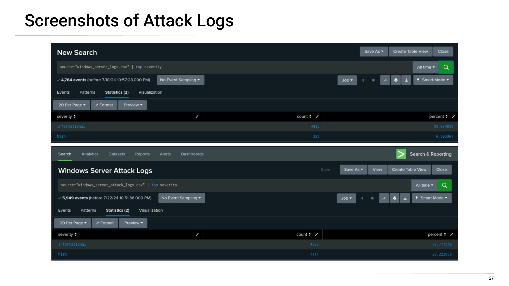
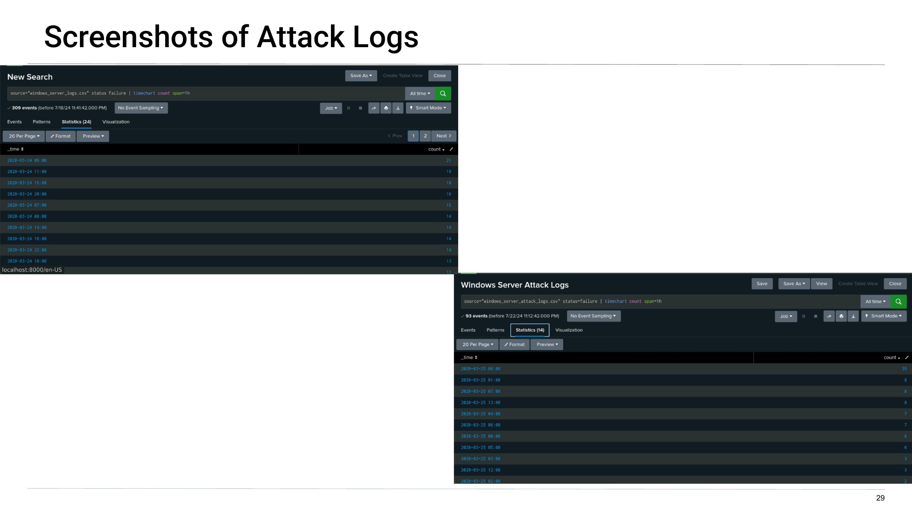
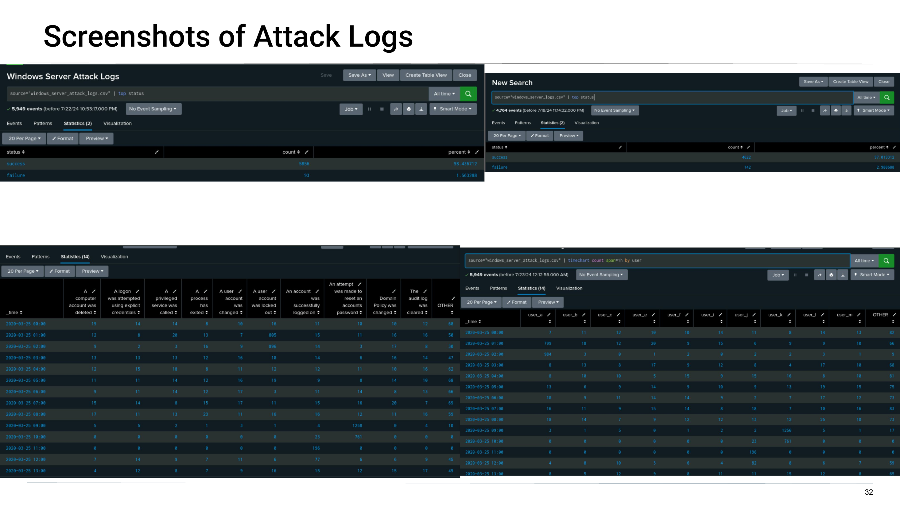
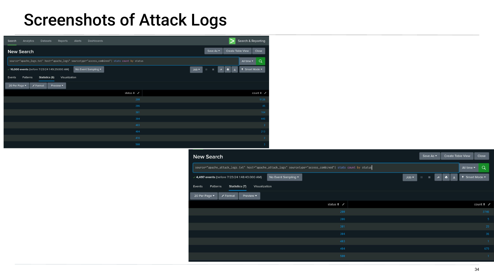
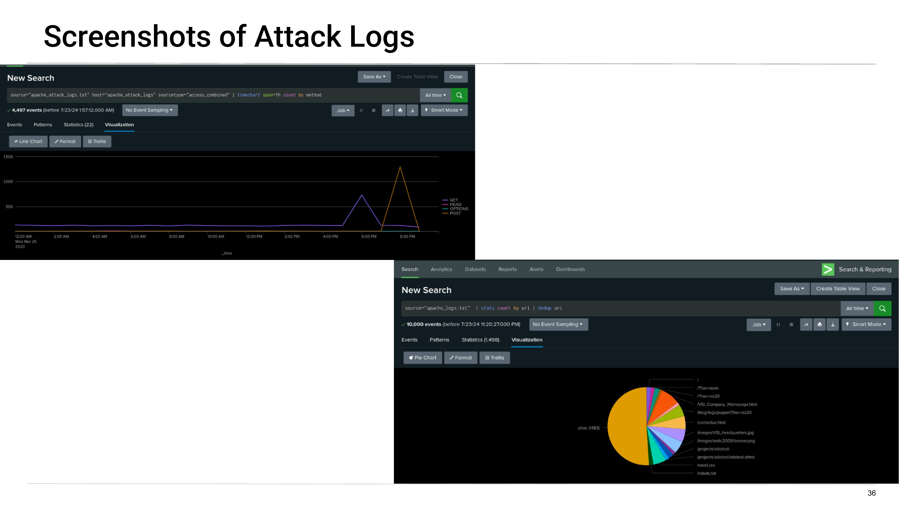
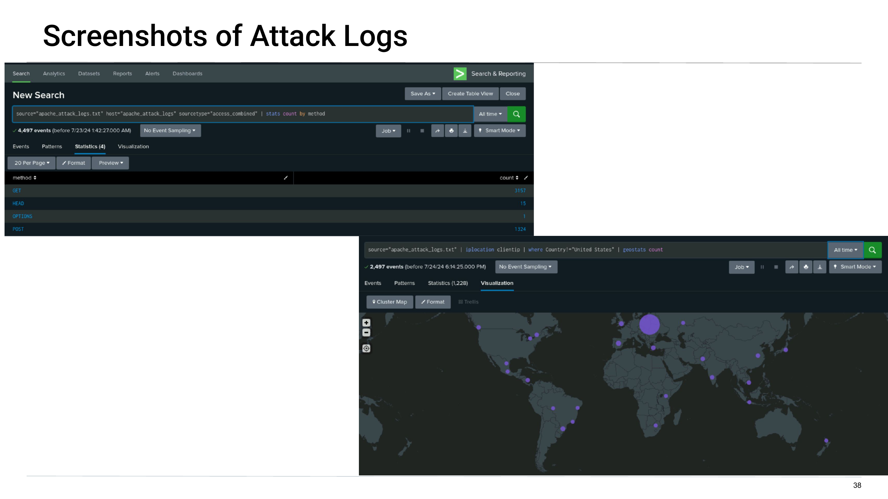
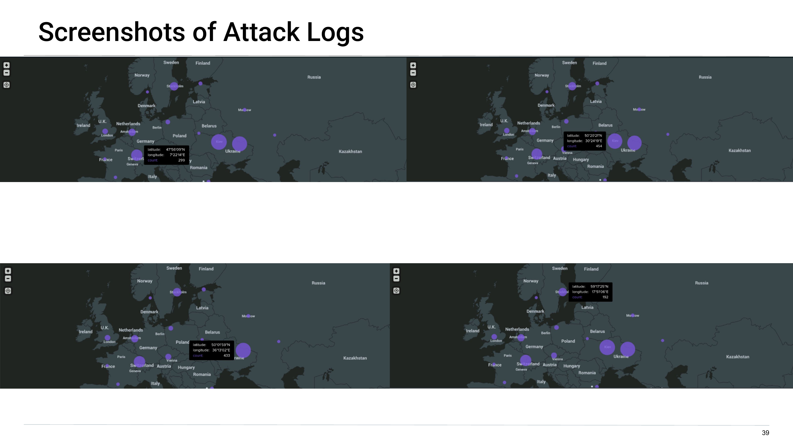

# SIEM Detection and Response: Splunk Monitoring for a Fictional Space Company

I played the SOC analyst for **Virtual Space Industries (VSI)**, a fictional company with a Windows server, an Apache web server and an admin web page. I built Splunk reports, dashboards and alerts from a **baseline** of normal activity, then ran the same searches on **attack logs** to see what the alerts caught and what they missed.

> **Scope note:** training scenario in a local Splunk Enterprise install, using sample datasets (`windows_server_logs.csv`, `apache_logs.txt` and their attack versions). The company and the attack are fictional. This is not production SOC work.

## What I did

1. Set up Splunk and loaded the Windows and Apache baseline logs.
2. Added a monitoring add-on for the VSI admin site (availability and response time).
3. Built **reports** (severity, status, signatures, users, HTTP methods, referrers, response codes).
4. Built **dashboards** (time charts, pie charts, a geo map of client IPs).
5. Set **alert baselines and thresholds** from the normal data.
6. Loaded the attack logs, re-ran everything, and wrote up what changed.

## Alerts I designed

| Log | Alert | Baseline | Threshold |
|---|---|---|---|
| Windows | Failed Windows activity (per hour) | 6 | 10 |
| Windows | Account successfully logged in | 12 | 21 |
| Windows | User account deleted | 10 | 21 |
| Apache | Non-USA activity (per hour) | 80 | 180 |
| Apache | HTTP POST count (per hour) | 3 | 12 |

Baselines came from the average hourly counts in the normal logs. Thresholds sit above the highest normal hour.

## Windows attack: what I found

The evidence points to a brute-force attack on the Windows server: repeated lockouts, a surge of password-reset attempts, then a rise in successful logons.

| Measure | Baseline | Attack |
|---|---|---|
| Events | 4,764 | 5,949 |
| "High" severity share | 6.9% | 20.2% |
| Failed activity, worst hour | 21 | **35** (Mar 25, 8:00 a.m.) |

- **Account lockouts** spiked (805 then 896 events in consecutive hours, around 1 to 2 a.m.), tied to `user_a`.
- **Password-reset attempts** spiked to **1,258** at 9 a.m., tied to `user_k` (1,256 events that hour).
- **Successful logons** jumped afterward, with `user_j` standing out. Some reset attempts appear to have worked.

## Apache attack: what I found

| Measure | Baseline | Attack |
|---|---|---|
| HTTP 404 responses | 213 of 10,000 events (2%) | 679 of 4,497 events (15%) |
| POST requests | 106 | 1,324 |

- GET traffic peaked around 6 p.m. (729) and **POST peaked around 8 p.m. (about 1,296)**.
- `/VSI_Account_logon.php` had unusually high volume, which fits login attempts.
- The geo map showed a large cluster in **Ukraine (887 events)**, with Switzerland second (299).

## Were the alerts right?

- **Worked:** the failed-activity alert fired on the attack (35 failures in an hour vs a threshold of 10).
- **Gap:** the successful-logon and account-deleted alerts did **not** fire, even though the dashboards showed a clear jump in successful logons after the reset attempts. A SOC would want that caught.

## What I recommended

- Two-factor authentication for accounts.
- Lock accounts after a set number of failed logins.

## What I would add next

- Alerts on **password-reset volume** and **account lockouts**, not just failures.
- Re-test every alert against the attack data before trusting it (my logon alert missed).
- Rate-limit or add a WAF rule for POSTs to the login page, and review the non-US source traffic.
- Correlate Windows and Apache events by time (the attack hit both).

## Honest notes

- **Sample data.** The datasets and the "VSI" company were provided for the exercise. I did the analysis, reports, dashboards and thresholds.
- **Thresholds are simple.** I set them from averages and the highest normal hour. A real SOC would tune against longer history to cut false positives.
- "Brute force" is a conclusion, not proof.** Total failed activity in the attack data (93) was lower than in the baseline (142), which is unusual for brute force. Confirming it would take per-attempt source IPs and usernames.
- **Attribution is limited.** "Ukraine" comes from IP geolocation. That shows where traffic appeared to come from, not who was behind it.

## Files

- `VSI_SIEM_Project_Deck.pdf`: the full slide deck
- `screenshots/`: key evidence pulled from the deck
